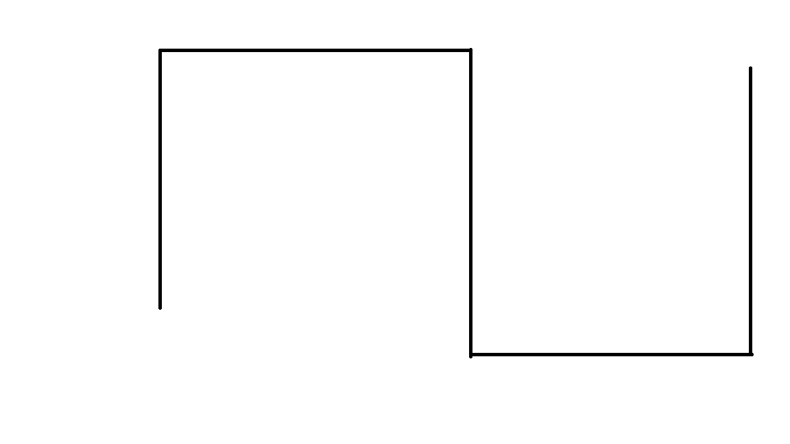

# Autonomous Robot Simulation (C++ / OpenCV)

A simulated mobile robot that explores a maze, follows walls and builds a map of its environment. It uses a simulated 360° LiDAR, and ArUco tags seen by its camera tell it which behavior to run.

School project (Polytech Dijon, robotics, Nov. 2025), built with my teammate [Mohamed Benha](https://github.com/benhamohamed05-afk).

<p align="center">
  
  <br><em>The maze the robot explores (black = walls).</em>
</p>

## What the robot does

- **Senses**: a simulated LiDAR casts 360 rays (1° step, 10 m range) on the map and returns the distance to the nearest wall.
- **Maps**: each scan updates an **occupancy grid**. Cells along each ray are marked free with Bresenham's line algorithm, and the impact points are marked as obstacles.
- **Decides**: the camera image goes through **ArUco detection** (OpenCV, `DICT_6X6_250`). The tag it sees selects the behavior:

| ArUco tag | Behavior |
|---|---|
| 0 | **Exploration**: boustrophedon sweep of the area, with obstacle avoidance (turns toward the most open LiDAR direction) |
| 5 | **Wall following**: proportional (P) control that keeps a set distance to the left wall, and slows down or turns when a wall is ahead |
| 10 | **Manual**: keyboard control |
| (automatic) | **Return home**: after the exploration, the robot drives back to its starting point |

- **Stays safe**: if a move brings the robot closer than 15 cm to a wall, the move is cancelled.

## Architecture

```
main.cpp ── perception ──> LiDAR, Camera
        ├── vision ──────> ArucoManager  (tag -> behavior)
        ├── decision ────> BehaviorManager
        │                    ├── Exploration
        │                    ├── WallFollow
        │                    ├── PathPlanner (return home)
        │                    └── KeyboardControl
        └── mapping ─────> OccupancyGrid (+ OpenCV display)
```

## My contributions

- ArUco tag detection (`ArucoManager`), the tag-to-behavior priority logic, and the marker generator (`generate_aruco`)
- Occupancy grid mapping from the LiDAR scans (`OccupancyGrid`)
- Obstacle avoidance in exploration, wall-following tuning (P gain, speed modulation) and the safety check
- Integration of all modules in `main.cpp`, plus headless tests (`test_aruco_detect`, `integration_test`)

My teammate wrote the robot model, the LiDAR and camera simulation, the behavior manager, the return-home planner and the keyboard control.

## Build and run

Requires a C++17 compiler, CMake ≥ 3.10 and OpenCV with the `aruco` module (on Ubuntu: `sudo apt install libopencv-dev`).

```bash
mkdir -p build && cd build
cmake ..
make
./robotsim            # run from build/: data files are loaded from ../data
./integration_test    # headless tests
./test_aruco_detect
```

In the simulation window, keys `1`, `2` and `3` force the manual, exploration and wall-following modes. `Esc` quits.

## Limitations

- Simulation only: the camera reads a fixed image (`data/test_aruco.png`) instead of a live webcam. `Camera.cpp` shows the two lines to change to use a real one.
- The robot uses its true pose (no odometry noise, no localization).
